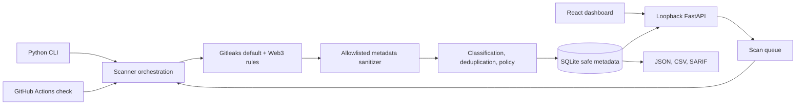

# Architecture and API

The backend binds to loopback. Vite proxies `/api` to port 8000 during development;
the backend can also serve `frontend/dist`. SQLite lives outside source control.
Gitleaks is invoked on demand with explicit argument lists, controlled config,
redaction, private temporary reports, deadlines and cancellation. Raw report
records pass through the sanitizer before they can enter any model or serializer.

The CLI `check` command uses scanner-core dependencies only, without FastAPI or a
database. CI installs hash-pinned PyYAML and does not build a package from the
untrusted target checkout.

## API contract

All routes use `/api/v1`. Development OpenAPI is available at `/api/openapi.json`
and `/api/docs`. Request models reject unexpected fields. Error responses use
`{"error":{"code":"...","message":"..."}}`; raw exception/scanner text and
invalid request values are not echoed.

| Method | Route | Purpose |
|---|---|---|
| GET | `/health`, `/system/status` | Process and scanner/rules readiness |
| GET/POST | `/repositories` | List/register canonical, allowlisted folders |
| DELETE | `/repositories/{id}` | Delete stored metadata, preserving local files |
| POST | `/demo` | Create a synthetic Git demo under an allowed root |
| GET/POST | `/scans` | Filter history/start an asynchronous scan |
| GET | `/scans/{id}` | Status, scope, versions, counts and safe errors |
| POST | `/scans/{id}/cancel` | Request cancellation |
| GET | `/scans/{id}/findings` | Paginated scan-specific findings |
| GET | `/scans/{id}/export?format=json` | Download all sanitized findings; JSON/CSV/SARIF |
| GET | `/findings`, `/findings/{id}` | Filter findings/detail with remediation |
| PATCH | `/findings/{id}` | Audited open/acknowledged/resolved triage |
| GET/POST | `/suppressions` | List/create reviewed, expiring suppressions |
| DELETE | `/suppressions/{id}` | End a reviewed suppression |
| GET | `/rules`, `/metrics/overview`, `/audit-events` | Policy information, metrics, audit |
| POST | `/ingest/scan-summary` | P1: authenticated ingestion of a sanitized CLI JSON report (`INGEST_TOKEN`; disabled by default) |
| GET/POST | `/attestations/{scan_id}` | P2: view/create a signed attestation (`ENABLE_BLOCKCHAIN=true` only) |
| POST | `/attestations/verify` | P2: verify a bundle (digest, signature, trusted signer, chain, optional registry) |

Start a scan with a registered `repository_id`, `mode` (`dir`, `git`, `both`),
optional `since_ref` and optional `fail_on`. Creation returns HTTP 202 with
`scan_id` and `status`; poll `/scans/{id}` until terminal. States are queued,
running, completed, failed and cancelled. Only completed scans have evaluated
policy (`pass`/`fail`). Error and cancelled states retain `not_evaluated`.

Downloads require a completed scan, include every finding independently of UI
pagination, use the CLI's shared safe serializers, and are marked `no-store`.
They do not contain absolute scan roots, secret values or source lines. CSV
fields neutralize leading spreadsheet formula operators. Remote-mode downloads
use the same in-memory bearer token as other API calls.
If a suppression review changes finding flags after a run, export requires a
rescan so the report cannot mix the old policy result with new finding counts.

The latest completed scan per repository drives current metrics. Historical
findings remain inspectable after a clean rescan. Triage is separate from
detection: acknowledgement does not remove a blocking result, and a resolved
finding detected again reopens. Suppression requires explicit review metadata.

## Code layout

| Path | Responsibility |
|---|---|
| `backend/secretsentinel/services/scanner.py` | Gitleaks orchestration: argv-only subprocess, deadline/cancel, private temp dir, `--redact=100`, repo-controlled ignore channels disabled or flagged |
| `backend/secretsentinel/services/sanitizer.py` | Deny-by-default projection of raw report records into `SafeFinding` |
| `backend/secretsentinel/services/finding_classifier.py`, `deduplicator.py` | Severity/confidence/remediation mapping; merging dir+git occurrences and overlapping rules |
| `backend/secretsentinel/services/policy.py` | Fail threshold, reviewed/expiring suppressions, baselines, `pass`/`fail`/`not_evaluated` |
| `backend/secretsentinel/services/exporters.py`, `reports.py` | Text/JSON/SARIF/CSV/GitHub output from sanitized data only |
| `backend/secretsentinel/services/jobs.py`, `store.py` | Background scan queue and persistence (status carry-over, audit events) |
| `backend/secretsentinel/services/attestation.py`, `chain.py` | P2 canonical payload, EIP-191 signing/verification, minimal JSON-RPC registry client |
| `backend/secretsentinel/main.py`, `api/` | FastAPI app, security middleware, routes |
| `backend/secretsentinel/cli.py` | `scan`, `check`, `baseline`, `rules`, `demo`, `doctor`, `serve`, `db`, `attest` |
| `rules/web3_rules.toml`, `rules/severity_mapping.yaml` | Ruleset (extends Gitleaks defaults) and its classification; both covered by the ruleset digest |
| `rules/fixtures/` | Positive fixtures as templates (values generated at test time) and benign negatives |
| `frontend/` | React dashboard, Vitest unit tests, Playwright E2E |
| `contracts/` | Optional `ScanRegistry` contract and Hardhat tests |

The PRD proposed `backend/app/`; the package is named `secretsentinel` instead so
it can be installed without claiming the generic top-level name `app`.
