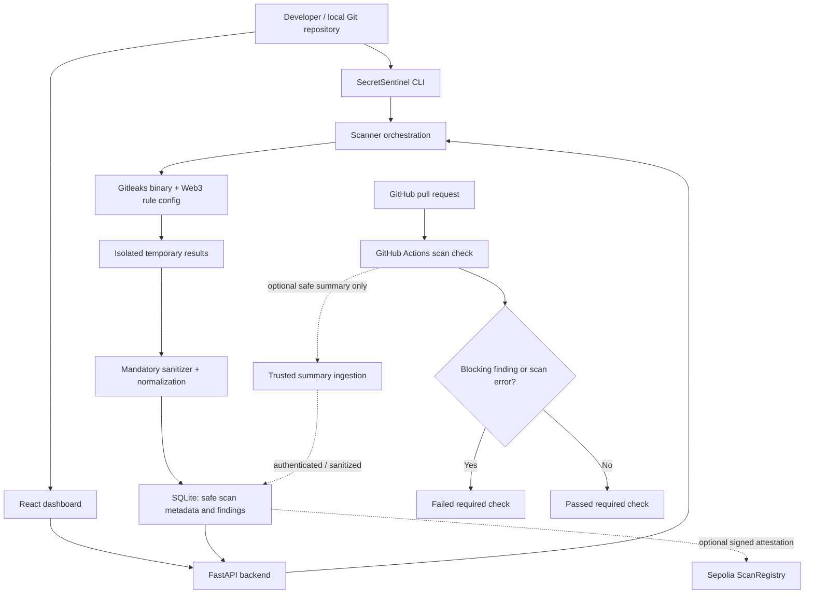
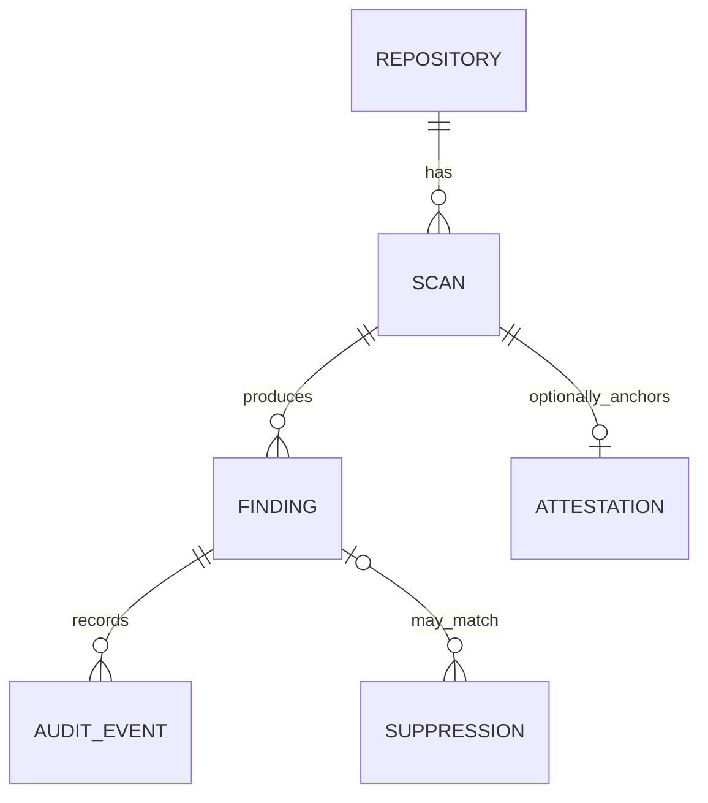

# SecretSentinel
## Product Requirements Document (PRD)

**Full title:** SecretSentinel: A Web3-Focused Secret Leakage Detection & DevSecOps Platform  
**Document version:** 1.0  
**Prepared:** 10 November 2026  
**Project type:** Cybersecurity · DevSecOps · Blockchain / Web3  
**Recommended implementation:** Local-first, Docker-free, Windows 11 compatible  
**Status:** Proposed / ready for development  
**Estimated timeline:** 3–4 weeks for a strong MVP; 1–2 additional weeks for optional blockchain features  
**License target:** MIT for original project code (subject to dependency license review)

> **One-sentence pitch:** SecretSentinel spots accidentally committed credentials, including Web3 wallet secrets, before they reach production, blocks unsafe merges through GitHub Actions, and presents safe, actionable security reports.

---

## 1. Executive summary

Developers sometimes commit API tokens, database passwords, cloud credentials, or cryptocurrency wallet secrets to repositories. Exposed secrets can be abused even if a developer later deletes the line from the current source file, because Git history may still retain it. Web3 projects face additional risk: a leaked wallet private key or seed phrase can mean irreversible asset loss.

SecretSentinel is a developer-focused secret detection platform with three primary interfaces:

1. **Command-line scanner:** inspect a project directory or local Git history using Gitleaks plus Web3-oriented custom rules.
2. **DevSecOps integration:** scan pull requests with GitHub Actions and fail the security check when a blocking finding exists. A configured branch ruleset/status-check requirement prevents merging.
3. **Web dashboard:** view redacted findings, severity, affected files, scan history, remediation guidance, and aggregate metrics.

An **optional blockchain extension** anchors a non-sensitive, signed scan-attestation digest on the Ethereum Sepolia test network. This adds auditability of attestations; it does **not** detect secrets, prove a repository is safe, or make untrusted scan results truthful.

### 1.1 Product vision

Make secret scanning an understandable, repeatable part of everyday development, including for small Web3 teams without enterprise security tooling or Docker-based infrastructure.

### 1.2 Product positioning

SecretSentinel is **not** a replacement for GitHub Secret Scanning, mature enterprise DLP products, or a dedicated security audit. It differentiates itself through its beginner-accessible local workflow, Web3-specific detection explanations, customizable policies, and an educational DevSecOps dashboard.

---

## 2. Problem statement

**Current pain points**

- Developers accidentally commit `.env` files, test credentials, deploy keys, API tokens, and wallet secrets.
- Removing secrets from the working tree does not necessarily remove them from historical commits or forks.
- Teams often discover incidents after code has already been pushed or deployed.
- Generic tools can flag high-entropy strings but offer insufficient Web3-specific remediation guidance.
- Terminal-only results are less approachable for people learning secure development.
- Without enforced CI checks, a team may forget to run scans before merging.
- Teams may want an audit trail showing which commit and policy were scanned, without exposing source code or findings.

**Core problem to solve:** detect likely secret exposures early, reduce the risk of unsafe merges, and help developers respond correctly without creating a second sensitive-data leak in logs, databases, or reports.

---

## 3. Audience and user personas

| Persona | Goals | Pain points | Core action |
|---|---|---|---|
| Student / solo developer | Learn secure CI/CD and protect personal projects | Few resources, little security experience | Run local scans and read fixes |
| Web3 developer | Protect wallet and RPC credentials | Private key leaks can be financially severe | Check Solidity, scripts, `.env` and Git history |
| Repository maintainer | Require secure merges | Inconsistent manual scans | Enable required GitHub check |
| Security reviewer | Triage and investigate findings | No consolidated history | Review findings, status and trend |
| Auditor (later phase) | Verify that a specific commit was scanned | Mutable, unverified reports | Validate a signed scan attestation |

**Primary persona for MVP:** a solo developer with a GitHub repository who wants a local scan, an understandable report, and a mandatory pull-request security check.

---

## 4. Goals, non-goals and success metrics

### 4.1 Product goals

- G1. Detect known credential patterns in local files and Git history.
- G2. Add targeted patterns for Web3 secrets with meaningful false-positive controls.
- G3. Ensure no raw secret reaches routine application logs, API responses, dashboard, hosted database, CI artifacts, or blockchain.
- G4. Make scan results actionable with severity, rule name, location, suggested response, and triage status.
- G5. Enforce a pass/fail security check on PRs using GitHub Actions.
- G6. Run on Windows 11 and standard GitHub-hosted runners without Docker or local virtual machines.
- G7. Optionally provide independently verifiable scan attestation provenance later.

### 4.2 Non-goals (initial release)

- Exploiting credentials, accessing unauthorized systems, or checking live wallet balances.
- Automatically rotating, revoking, or transferring funds using detected credentials.
- Fully replacing dedicated code scanning, SAST, malware scanning, dependency auditing, or external pentesting.
- Guaranteeing detection of every secret or correctness of every scan.
- Directly accepting arbitrary public URLs and cloning/scanning them server-side.
- Supporting many organizations, complex RBAC, or billing in MVP.
- Writing secret values or full repository contents to any public blockchain.
- Running untrusted repository scripts during scanning.

### 4.3 Initial acceptance targets (engineering goals, not measured claims)

| Metric | MVP target | Measurement |
|---|---|---|
| Known synthetic secret detection | ≥ 90% on a curated, versioned fixture set | True positives / planted positives |
| False-positive rate | ≤ 10% on a curated benign fixture set | Incorrect detections / benign test cases |
| Safe reporting | 0 raw fixture secrets in persisted data, APIs, browser views, CI logs, and artifacts | Automated redaction test suite |
| CI correctness | 100% of fixture PRs with blocking findings fail | Workflow integration tests |
| Basic scan latency | ≤ 30 seconds for a small fixture repo (< 1,000 files), excluding dependency installation | Timed local benchmark |
| Onboarding | A new user can complete a scan using the README | Manual setup walkthrough |
| Dashboard | Filter and inspect sanitized findings without the original secret | UI acceptance test |

These are development targets and should be adjusted based on benchmark results and hardware.

---

## 5. Scope and release plan

### 5.1 MVP (P0: must have)

- Local directory scan and Git history scan.
- Gitleaks integration with safe execution and clear scan-state reporting.
- Inherited default rules plus a carefully tested set of Web3-specific rules.
- Findings sanitizer, stable non-secret finding IDs, and duplicate grouping.
- Severity classification and remediation text.
- Python FastAPI backend with SQLite and local-only binding by default.
- React dashboard: overview, scans, findings, finding details, settings.
- GitHub Actions PR scanner with least-privilege permissions and nonzero CI failure on qualifying leaks.
- Basic baseline/allowlist support with reasons and review instructions.
- Synthetic fixture suite, unit tests, GitHub Actions tests, and README.

### 5.2 Enhanced version (P1: should have)

- Full baseline management with reviewed expirations and audit notes.
- Scheduled scans on default branch, with trend analytics.
- Optional authenticated ingestion of sanitized scan summaries from a trusted workflow.
- Export sanitized JSON/CSV/SARIF where supported and safe.
- Ruleset configuration in a GUI.
- Basic authentication for a remotely hosted dashboard (local-only mode needs none).
- GitHub repository metadata and recent-check links (no code cloning via web API required).

### 5.3 Blockchain extension (P2: optional)

- Canonical scan-attestation JSON and signed digest.
- Solidity registry on Sepolia for scan attestation hashes and signer addresses.
- Verification view for record existence, signer, commit identity and digest match.
- No on-chain findings, secrets, raw paths, personal data, repository URLs, or full security reports.
- Clear warning that immutability does not imply scan accuracy.

### 5.4 Possible future enhancements (P3)

- IDE extension, pre-commit integration, GitHub App, multi-tenant SaaS.
- Security notifications with privacy-safe metadata.
- OpenSSF/SLSA provenance integration, stronger key management, third-party attestation review.
- Organization-specific policy profiles, centralized user management, advanced dashboards.

---

## 6. User journeys

### Journey A: Local project inspection

1. Developer installs Python, Git, Gitleaks and the project dependencies.
2. Developer runs `secretsentinel scan dir .` or selects an authorized local folder from the local application.
3. Scanner evaluates eligible files without executing repository content.
4. Scanner creates **sanitized findings only**, stores them in SQLite and returns a clear pass/fail result.
5. Dashboard shows a summary and links to details, such as `src/config.py:18`, rule ID and remediation advice.
6. Developer removes the leak, revokes/rotates the real credential as needed, and rescans.
7. The new run records the finding as no longer detected; the historical record remains for authorized review.

### Journey B: Pull request protection

1. Contributor opens or updates a pull request.
2. GitHub Actions scans code/history within the configured policy scope.
3. The check is marked failed if a blocking finding is found, or if the scanner fails or times out (fail closed).
4. The developer sees only safe metadata in the logs (never secret snippets).
5. Branch protection/rulesets require the check to pass before merge. Merely failing the check without branch protection does **not** prevent merges.
6. Developer fixes and reruns the check. A newly passing check permits normal review and merge.

### Journey C: Web3 key accidentally committed

1. A Web3 application contains a suspicious private-key assignment or wallet mnemonic in a fixture file.
2. Web3 rule marks it as a **candidate**, with context-based scoring and high-risk classification where justified.
3. The dashboard explains: treat a real exposed private key/seed as compromised; migrate funds to a new wallet if appropriate, revoke app/API access, and remove traces according to incident response policy.
4. The application does **not** use, validate against live assets, or transmit the candidate key.
5. The developer marks the incident remediated after independently completing the required response.

### Journey D: Optional proof verification

1. A trusted workflow completes a scan of a specific commit using a specified scanner and policy version.
2. It signs a canonical attestation containing the commit identifier, scan status, scanner version, timestamp and report digest.
3. An authorized publisher records the attestation digest on Sepolia.
4. The verifier recomputes the digest and validates the signature and transaction against the expected signer.
5. The UI reports **“Attestation verified”**, not **“Code verified secure.”**

---

## 7. Functional requirements

Use requirement IDs for project boards and test cases.

### 7.1 Scanner

| ID | Priority | Requirement | Acceptance criteria |
|---|---|---|---|
| SCAN-01 | P0 | Scan a user-authorized directory | Files are inspected without running code from the repository |
| SCAN-02 | P0 | Scan Git history | Prior commits in scope are included, with commit identifiers where available |
| SCAN-03 | P0 | Use Gitleaks default rules | Common token/password patterns are detected |
| SCAN-04 | P0 | Support Web3 custom rules | Covered test patterns produce expected candidate findings |
| SCAN-05 | P0 | Include rule, location, severity and safe fingerprint | Response contains no raw secret or unredacted line |
| SCAN-06 | P0 | Handle clean, findings, error, timeout states separately | Errors never appear as clean scans |
| SCAN-07 | P0 | Deduplicate identical rule/location/occurrence as appropriate | No duplicate finding cards for one scan occurrence |
| SCAN-08 | P0 | Ignore excluded folders/paths by explicit policy | `.git` handling appropriate to mode; build outputs can be excluded |
| SCAN-09 | P1 | Support baseline and reviewed suppressions | Existing accepted findings are distinguished from new findings |
| SCAN-10 | P1 | Cancel a long-running scan | Process stops safely; scan is marked cancelled |

**Scanner modes:**

- `dir`: current directory/file content; catches uncommitted changes, cannot detect deleted history.
- `git`: Git history in configured scope; catches committed historic leaks, may not capture all untracked working changes.
- `both`: run both and deduplicate by a stable safe identifier.

**Initial CLI shape (proposed):**

```text
secretsentinel scan dir <local-path>
secretsentinel scan git <local-repo-path>
secretsentinel scan both <local-repo-path>
secretsentinel scan dir . --format json --output safe-report.json
secretsentinel check . --fail-on high
```

Commands above define **the new SecretSentinel wrapper to implement**, not existing Gitleaks commands.

**Underlying Gitleaks examples, subject to the locally installed release:**

```bash
gitleaks version
gitleaks dir --redact=100 .
gitleaks git --redact=100 .
```

Gitleaks versions support directory and Git scanning plus custom TOML rule configuration. Do not treat `--redact` alone as a guarantee that every output field or file is safe. The SecretSentinel sanitizer must be applied before serialization/persistence.

### 7.2 Web3 detection policy

| ID | Priority | Candidate class | Detection approach | Important limitation |
|---|---|---|---|---|
| W3-01 | P0 | EVM private key assignment | 64-hex candidate plus nearby key-related identifier/context | A bare 64-hex string can be a hash, not a private key |
| W3-02 | P0 | Seed / mnemonic variable | 12/15/18/21/24-word candidate near mnemonic/seed identifiers | Word count alone does not establish a valid or sensitive phrase |
| W3-03 | P0 | Web3 RPC or provider API credentials | Known provider token patterns and credential-like URL/query fields | Public endpoint URLs are not automatically secrets |
| W3-04 | P0 | Hardcoded wallet/signing secrets | Contextual variable names, assignment patterns and entropy | Must avoid flagging public addresses as private keys |
| W3-05 | P1 | Keystore/backup files | Risky file paths and file contents where safe to inspect | Not every keystore file contains plaintext secrets |
| W3-06 | P1 | Deployment secrets | Typical CI/private deploy variables and keys | Generic rule coverage may overlap |

**Rule design principles:**

- Start from Gitleaks default configuration; extend it rather than replacing it accidentally.
- Prefer context (`PRIVATE_KEY=`, `MNEMONIC=`, `SEED_PHRASE=`, `SIGNER_KEY=`) over isolated random-looking values.
- Recognize that Ethereum addresses, transaction hashes, public keys, and contract addresses are **not** automatically sensitive.
- Flag mnemonic-shaped strings as candidates; do not test real mnemonic/private keys against public services.
- Never collect, save, or show full suspected secret values.
- Keep synthetic fixtures distinct from actual credentials, and label them accordingly.
- Record detection engine and rule-set versions with every scan.
- Custom regex should be written for Gitleaks' Go-compatible regex engine; Python-only syntax may not work.

### 7.3 Findings and triage

| ID | Priority | Requirement | Acceptance criteria |
|---|---|---|---|
| FIND-01 | P0 | Display redacted finding type, rule, severity, file and line | No raw match/secret text or unfiltered source excerpts |
| FIND-02 | P0 | Show remediation guidance | Relevant, concise next steps shown for each rule family |
| FIND-03 | P0 | Filter by severity, status, rule, mode and scan | Filters return correct records |
| FIND-04 | P0 | Mark status: open, acknowledged, resolved | Authorized user can change status with an audit timestamp |
| FIND-05 | P0 | Avoid mislabeling results | “No findings detected” rather than “100% secure” |
| FIND-06 | P1 | Support reviewed false-positive / suppression decision | Requires justification and reviewer in authenticated mode |
| FIND-07 | P1 | Suppression expiry or re-review date | Expired suppressions stop bypassing gating checks |

**Default severity guidance (configurable):**

| Severity | Example | Default policy |
|---|---|---|
| Critical | Confirmed or strongly contextual private signing key / mnemonic candidate | Block and prompt urgent response |
| High | Cloud/service credentials, token patterns, high-confidence signing secret | Block |
| Medium | Ambiguous potential secret with moderate confidence | Warn by default, optionally block |
| Low | Weak pattern or explicitly synthetic fixture | Inform only |

Severity indicates **detector risk estimate**, not proof that a credential is live, exploited, or valid.

### 7.4 CI/CD requirements

| ID | Priority | Requirement | Acceptance criteria |
|---|---|---|---|
| CI-01 | P0 | Trigger on pull requests to protected branches | Security job runs for relevant PRs |
| CI-02 | P0 | Use minimum GitHub token permissions | `contents: read`; no deployment secrets on untrusted PRs |
| CI-03 | P0 | Fail security job on unsuppressed blocking findings | GitHub check reports failure |
| CI-04 | P0 | Fail closed on scanner/process errors | Error check is not marked green |
| CI-05 | P0 | Never publish raw reports or suspected secrets | Logs/artifacts contain only sanitized summaries |
| CI-06 | P0 | Document required status check configuration | Protected merge cannot proceed while check fails |
| CI-07 | P1 | Allow documented baseline for pre-existing exposure | New leaks block, historical findings are still surfaced |
| CI-08 | P1 | Scheduled scan of default branch | Scheduled runs produce sanitized summaries |

**CI security constraints:**

- Use the `pull_request` event for untrusted PRs. **Do not use `pull_request_target` to checkout/execute untrusted PR content with privileged credentials.**
- No wallet, deployment, repository-admin, or scanner-ingestion secrets in PR jobs.
- Set workflow `permissions: contents: read` unless a specific operation demonstrably needs more.
- Pin third-party actions and downloaded executables to reviewed versions/digests; consider full commit SHA pinning.
- For full history, configure `actions/checkout` with adequate fetch depth; scanning only the default shallow checkout can miss history.
- Do not invoke repository code (e.g., package install hooks, arbitrary tests) as part of secret scanning.
- A separate trusted workflow may ingest **sanitized** main-branch results, with careful workflow/artifact verification. Do not grant PR scanning jobs a write-capable backend credential.
- Configure a required status check in GitHub branch protection/rulesets. Enforcement depends on repository plan and settings.

### 7.5 Dashboard

| ID | Priority | Requirement | Acceptance criteria |
|---|---|---|---|
| UI-01 | P0 | Overview with scans, open findings and severity counts | Summary matches database |
| UI-02 | P0 | Scan history view | Run time, mode, result, scanner version visible |
| UI-03 | P0 | Finding list and detail panel | Redacted location, rule, severity, advice, status |
| UI-04 | P0 | Start scan via local backend on an explicitly selected, allowed path | No arbitrary remote server paths or URL cloning |
| UI-05 | P0 | Responsive presentation, clear empty/error/loading states | Works on laptop and phone widths |
| UI-06 | P1 | Trends across scans | Charts are keyed to repo and time window |
| UI-07 | P1 | Baseline/suppression management | Changes require rationale and are auditable |
| UI-08 | P2 | Attestation verification | Verified state includes signer and digest match |

**Recommended screens:** Overview, New Scan, Findings, Finding Details, Scan History, Rules & Policy, Settings, and optional Attestations.

---

## 8. Architecture

### 8.1 System overview



### 8.2 Major components

**Frontend: React + Vite + Tailwind CSS**

- Local dashboard UI; Fetch/Axios calls to backend.
- Renders **only normalized/redacted fields** returned by API.
- No wallet keys or third-party secrets stored in `localStorage`.

**Backend: Python + FastAPI**

- Validates requests and allowed filesystem paths.
- Orchestrates Gitleaks via `subprocess` with **argument lists, never `shell=True`**.
- Sets timeouts and file/repository-size limits.
- Uses isolated temporary directories with restrictive permissions.
- Sanitizes findings before writing to SQLite.
- Adds local-only CORS and loopback binding in default development mode.

**Detection engine: Gitleaks + Web3 rules**

- Gitleaks performs regex/entropy scanning.
- Custom TOML rules extend the default policy.
- Python normalizes severity and remediation content.

**Persistence: SQLite in MVP**

- Stores scan metadata, safe findings, review states and policies.
- Must never store full source snippets, raw secrets, raw Gitleaks reports, mnemonic phrases, full wallet private keys, or logs that may contain them.

**CI: GitHub Actions**

- Runs safe checks on PRs, using a supported executable installation mechanism.
- Reports pass/fail independently of the dashboard's uptime.

**Optional blockchain**

- Uses a testnet contract to anchor one-way digests of structured, non-sensitive attestations.
- Signer provenance and scanner policy version are validated by the client, not merely accepted from the contract.

### 8.3 Design choice: local-first versus public SaaS

The **default** product is local-first. That keeps repository paths and security findings on the user's machine and avoids collecting third-party GitHub tokens. A publicly hosted service requires authentication, authorization, hardening, operational monitoring, and careful ingestion; it is a P1/P3 expansion, **not** a requirement for a successful student MVP.

---

## 9. Proposed project structure

```text
SecretSentinel/
├── README.md
├── LICENSE
├── .gitignore
├── .gitleaks.toml
├── .env.example
├── docs/
│   ├── PRD.md
│   ├── ARCHITECTURE.md
│   ├── THREAT_MODEL.md
│   ├── SETUP_WINDOWS.md
│   └── TEST_PLAN.md
├── frontend/
│   ├── package.json
│   ├── vite.config.js
│   ├── index.html
│   └── src/
│       ├── App.jsx
│       ├── main.jsx
│       ├── api/client.js
│       ├── components/
│       │   ├── Sidebar.jsx
│       │   ├── SeverityBadge.jsx
│       │   ├── ScanStatus.jsx
│       │   └── FindingTable.jsx
│       ├── pages/
│       │   ├── Overview.jsx
│       │   ├── NewScan.jsx
│       │   ├── Scans.jsx
│       │   ├── Findings.jsx
│       │   └── Settings.jsx
│       └── styles/index.css
├── backend/
│   ├── pyproject.toml
│   ├── app/
│   │   ├── main.py
│   │   ├── core/config.py
│   │   ├── core/security.py
│   │   ├── api/routes_scans.py
│   │   ├── api/routes_findings.py
│   │   ├── api/routes_metrics.py
│   │   ├── models.py
│   │   ├── schemas.py
│   │   ├── database.py
│   │   └── services/
│   │       ├── scanner.py
│   │       ├── sanitizer.py
│   │       ├── finding_classifier.py
│   │       ├── deduplicator.py
│   │       └── remediation.py
│   └── tests/
│       ├── test_scanner.py
│       ├── test_sanitizer.py
│       ├── test_rules.py
│       └── test_api.py
├── cli/
│   └── secretsentinel_cli.py
├── rules/
│   ├── web3_rules.toml
│   ├── severity_mapping.yaml
│   └── fixtures/
│       ├── synthetic_positive/
│       └── benign_negative/
├── contracts/                 # P2 only
│   ├── ScanRegistry.sol
│   └── test/
├── scripts/
│   ├── bootstrap_windows.ps1
│   ├── run_scanner.ps1
│   └── check_no_raw_secrets.py
└── .github/
    └── workflows/
        ├── secret-scan.yml
        └── backend-tests.yml
```

Folder/file names are proposed and may be adjusted during implementation. Keep scan fixture content entirely synthetic.

---

## 10. Data design

### 10.1 Entities

**Repository**

- `id` UUID, primary key
- `display_name` string; local alias only
- `canonical_local_path` string; **local database only, never published or on-chain**
- `created_at`, `updated_at`

**Scan**

- `id` UUID, primary key
- `repository_id` foreign key
- `mode` enum (`dir`, `git`, `both`, `ci`)
- `status` enum (`queued`, `running`, `completed`, `failed`, `cancelled`)
- `policy_result` enum (`pass`, `fail`, `not_evaluated`)
- `commit_sha` optional 40-character Git SHA-1 or repository-supported object ID
- `scanner_name`, `scanner_version`, `ruleset_digest`
- `started_at`, `finished_at`
- `total_findings`, `blocking_findings`
- `error_code` optional controlled error enum; **no unfiltered exception text**

**Finding**

- `id` UUID, primary key
- `scan_id` foreign key
- `fingerprint` non-secret stable identifier
- `rule_id`, `rule_family`, `severity`, `confidence`
- `relative_path`, `start_line`, `commit_sha` (location metadata may be considered sensitive in shared deployments)
- `status` (`open`, `acknowledged`, `resolved`, `suppressed`)
- `remediation_key`
- `first_seen_at`, `last_seen_at`
- **No `secret`, `match`, or original source `line` field.**

**Suppression / baseline entry**

- `id`, `rule_id`, `finding_fingerprint` or narrowly scoped selector
- `reason`, `reviewer_id` (where authenticated), `created_at`, `expires_at`
- `active` boolean

**Audit event**

- `id`, `actor`, `action`, `entity_id`, `occurred_at`, `safe_metadata_json`

**Attestation (P2)**

- `id`, `scan_id`, `attestation_digest`, `signature`, `signer_address`
- `chain_id`, `contract_address`, `transaction_hash`, `published_at`

### 10.2 Relationships



### 10.3 Stable finding ID strategy

- Do **not** derive a public fingerprint directly from a raw secret with an unsalted hash; low-entropy values could be guessed offline.
- MVP fingerprint can be a random UUID per finding occurrence, with a separate local deduplication index based on rule ID, repository ID, normalized location and detector-supplied non-secret fingerprint **only after review of its contents**.
- If cross-scan matching requires hashing sensitive derived material, use a keyed HMAC with a local secret that is never transmitted, or prefer non-sensitive location/rule identity and accept some duplicate churn.
- On-chain attestations must use scan-level non-sensitive metadata digests, **never raw-secret-derived fingerprints**.

### 10.4 Safe JSON finding example

```json
{
  "id": "43cc77d6-e1be-47aa-a338-3d827bc5a5a9",
  "rule_id": "web3-possible-private-key",
  "type": "Potential EVM signing secret",
  "severity": "critical",
  "confidence": "medium",
  "relative_path": "src/config.js",
  "start_line": 21,
  "secret": null,
  "status": "open",
  "remediation_key": "ROTATE_SIGNING_KEY"
}
```

The `secret: null` is shown here only to emphasize non-retention; the actual API should omit the field entirely.

---

## 11. REST API specification (MVP)

**Base URL:** `http://127.0.0.1:8000/api/v1` (local mode).  
**Contract:** JSON request/response; OpenAPI automatically documented via FastAPI in development.

| Method | Endpoint | Purpose | Response |
|---|---|---|---|
| `GET` | `/health` | Basic liveness | `{ "status": "ok" }` |
| `GET` | `/repositories` | Local repository aliases | Array of repositories |
| `POST` | `/repositories` | Register explicit allowed local folder | Repository ID |
| `POST` | `/scans` | Start scan for registered repository and mode | `202`, scan ID |
| `GET` | `/scans` | List scans with pagination and filters | Paginated scans |
| `GET` | `/scans/{scan_id}` | Scan status, safe summary | Scan object |
| `GET` | `/scans/{scan_id}/findings` | Findings for scan | Paginated safe findings |
| `GET` | `/findings/{finding_id}` | Redacted finding details | Finding object |
| `PATCH` | `/findings/{finding_id}` | Update triage status | Updated finding |
| `GET` | `/metrics/overview` | Summary counts/trends | Metrics object |
| `GET` | `/rules` | Rule metadata and severity mappings | Rules list |
| `GET` | `/attestations/{scan_id}` | P2 attestation status | Optional attestation |

**Example: start a local scan**

```http
POST /api/v1/scans
Content-Type: application/json

{
  "repository_id": "01eaef8c-cfb4-45c7-9504-8a054e0364af",
  "mode": "both"
}
```

```http
HTTP/1.1 202 Accepted
Content-Type: application/json

{
  "scan_id": "4ea88069-a486-49d7-b6cd-47d690097967",
  "status": "queued"
}
```

**API rules:**

- Accept **registered repository IDs**, not arbitrary filesystem paths on each scan request.
- Canonicalize paths, check an explicit approved root, reject symlink/path escapes, enforce maximum size and allow cancellation.
- Use a background **local process/job queue** so scan requests do not block the HTTP request thread; this is ordinary in-app execution, not a promise to deliver results later in a conversation.
- API errors use controlled codes (`SCANNER_NOT_FOUND`, `SCAN_TIMEOUT`, `UNSUPPORTED_REPO`, `SANITIZATION_FAILED`, etc.).
- Never return raw command stdout/stderr to browser clients.
- Local app must bind to loopback by default. If exposed on a LAN or cloud host, implement login, HTTPS, CSRF/CORS controls as appropriate, access checks, and rate limiting.
- Do not provide unrestricted server-side repository cloning as a convenience shortcut.

---

## 12. Secure scanning and data-handling pipeline

### 12.1 Pipeline specification

1. Validate an approved, canonical local target path.
2. Determine `dir`, `git`, or `both` mode and check Git repository availability.
3. Launch pinned Gitleaks executable with `subprocess.run([...], shell=False, timeout=...)` or managed subprocess equivalent.
4. Supply a controlled ruleset and redaction flags.
5. Temporarily capture scan data in a local, access-restricted directory that is excluded from repository checkout and from default scanner paths.
6. Parse the result into in-memory fields; treat source matches, original lines, and raw report text as sensitive.
7. Run deny-by-default allowlisting of output fields and reject unexpected serialized fields. Strip full source lines, `Secret`, `Match`, and any untrusted free text.
8. Write only sanitized records to database or UI.
9. Remove temporary reports promptly even on exceptions/cancellation, recognizing that deleting a file is not guaranteed secure erasure on all filesystems.
10. Evaluate blocking policy separately from scan execution outcome; a process crash must not become a pass.

**Security invariants:**

- `S1`: raw candidate secret values never cross an application API boundary.
- `S2`: no raw candidate secrets are persisted in routine reports, dashboards, CI artifacts, analytics or blockchain.
- `S3`: a scanner error results in `scan failed`, never a clean/pass result.
- `S4`: the scanner never executes code from the target repository.
- `S5`: real credential rotation and incident response remain human-directed.

### 12.2 Handling sensitive matches

- Full redaction (`--redact=100`) is a useful defense, not the only one.
- Build normalized objects using a **strict list of safe keys**, never `serialize(raw_gitleaks_result)`.
- Do not log CLI commands with secret-containing arguments; prefer paths and config files, no values on the command line.
- Do not expose arbitrary error text from tool invocations.
- Include tests that search every backend response, SQLite dump, CI log and exported report for synthetic fixture values.
- Even apparently benign file names/paths, commit messages and email metadata may disclose information; scope them to local/authenticated users only.

### 12.3 False positives and baseline policy

- Label suspicious candidates carefully; a 64-character hexadecimal constant may be a hash or sample data.
- Support rule/path-specific exclusions only after review.
- Suppressions must have an explanation and ideally expiration.
- Baselines help avoid blocking every new PR due to pre-existing history findings, but must not silently excuse known live secrets.
- Rotate a real exposed credential **even if** the committed file has been removed or rewritten; deleting the line does not revoke the credential.

---

## 13. GitHub Actions design

### 13.1 Trigger and permissions

```yaml
name: SecretSentinel Security Scan
on:
  pull_request:
    branches: [main]
  workflow_dispatch:
permissions:
  contents: read
jobs:
  secret-scan:
    runs-on: ubuntu-latest
    steps:
      - name: Checkout repository
        uses: actions/checkout@v4 # In production, pin a reviewed full commit SHA.
        with:
          fetch-depth: 0
      - name: Set up SecretSentinel and Gitleaks
        run: echo "Install pinned scanner releases with checksum verification"
      - name: Run scan and enforce policy
        run: echo "Replace with the implemented secretsentinel check command"
```

> **Important:** This is a **workflow outline**, not a ready-to-run security gate. The two `echo` placeholders must be replaced with actual installation and scanning commands before enabling required checks. A placeholder workflow must **never** be treated as protecting a branch.

### 13.2 CI behavior

- On each PR, run a deterministic policy (prefer new/changed history with an explicit baseline for known older findings; document choice).
- Gitleaks scan uses approved rule config and a checked version.
- Return `0` only if scan completed successfully and no unsuppressed blocking secrets were found.
- Return nonzero for blocking leaks, tool execution failure, invalid config, and timeout, with **distinct error messages but no sensitive snippets**.
- Keep findings local to CI unless a separately designed sanitized report step is proven safe.
- For fork PRs, no secrets must be required to perform the scan.
- In GitHub settings, require the `secret-scan` job to pass via protected-branch ruleset/required status checks.
- Avoid privileged `pull_request_target` handling of untrusted code.

### 13.3 Deployment interaction

A passing secret scan is a **necessary** check in a protected release workflow, not a universal guarantee of safety. A production deployment job may depend on successful build, tests, SAST and SecretSentinel checks, but should use separately protected deployment credentials and environment approvals.

---

## 14. User interface and UX requirements

### 14.1 Layout concept

**Visual style:** modern dark cybersecurity dashboard, high-contrast typography, restrained accent colors, responsive tables, and accessible status labels. A dark theme is an aesthetic option, not a functional dependency.

**Overview card layout:**

```text
┌────────────────────────────────────────────────────────────────┐
│ SecretSentinel                                 [New Scan]      │
├────────────────────────────────────────────────────────────────┤
│ Repositories  │ Completed scans │ Open findings │ Blocked PRs* │
│      2        │       15        │      3        │      1       │
├────────────────────────────────────────────────────────────────┤
│ Findings by severity          │ Scan history                   │
│ Critical: 1                   │ #15  Git  PASS / FAIL           │
│ High:     2                   │ #14  Dir  PASS                 │
│ Medium:   0                   │ #13  Git  PASS                 │
├────────────────────────────────────────────────────────────────┤
│ Finding   │ Severity │ File        │ Line │ Status           │
│ Web3 key  │ Critical │ config.js   │  21  │ Open             │
│ API token │ High     │ app.py      │  48  │ Acknowledged     │
└────────────────────────────────────────────────────────────────┘
*Only when CI-status integration is implemented.
```

### 14.2 Finding detail content

A finding detail should present:

- Rule ID and friendly title.
- Severity and confidence, explicitly labeled as estimates.
- Repository alias, safe relative path, line number and optional commit reference.
- First/last seen and triage status.
- Explanation of the risk.
- Recommended incident response / remediation.
- Suppression controls only when permitted.
- **No view/reveal-secret button.**

### 14.3 Empty, error and accessibility states

- Clean scan: “No matching secrets detected in the scanned scope.”
- Failed scan: “Scan could not complete; security status is unknown.”
- No scans: onboarding steps and a sample fixture option.
- Loading: show job progress and prevent duplicate requests.
- Accessibility: keyboard access, labeled controls, screen-reader-friendly statuses, contrast, and color-independent severity cues.

---

## 15. Blockchain module (P2, optional)

### 15.1 Why blockchain is optional

The main problem is solved by secret scanning plus enforced CI policy. Blockchain can provide a tamper-evident record of **claims that a scan happened**, which may be useful when separate teams or external reviewers need to compare attestations. It is not needed for everyday secret detection.

### 15.2 Contract design: `ScanRegistry.sol`

**Target:** Ethereum Sepolia testnet only for development/demo.

**Suggested contract responsibilities:**

- Register an attestation digest (`bytes32`) for a scan identifier/digest.
- Record publisher address and block timestamp through a contract event.
- Prevent duplicate publishing for the same attestation digest, or define explicit replay semantics.
- Permit only an approved publisher role (OpenZeppelin `AccessControl` or `Ownable` for a simpler single-admin demo).
- Support a read method `isRegistered(bytes32 digest)`.

**Possible interface (illustrative, not compiled Solidity):**

```text
registerAttestation(bytes32 attestationDigest)
isRegistered(bytes32 attestationDigest) -> bool
AttestationRegistered(bytes32 indexed attestationDigest,
                      address indexed publisher,
                      uint256 timestamp)
```

### 15.3 Attestation payload

Use a canonical JSON serialization scheme with fixed field order/canonicalization rules. **Proposed fields:**

```json
{
  "schema_version": "1",
  "scan_id": "4ea88069-a486-49d7-b6cd-47d690097967",
  "commit_sha": "0123456789abcdef0123456789abcdef01234567",
  "scanner": "SecretSentinel",
  "scanner_version": "1.0.0",
  "ruleset_sha256": "<sha256-of-published-ruleset>",
  "status": "completed",
  "policy_result": "pass",
  "blocking_findings_count": 0,
  "completed_at": "2026-11-10T10:00:00Z"
}
```

Replace placeholders with real computed values when implemented; the commit SHA shown is a dummy example. **Before publication, decide whether commit IDs themselves reveal private repository information.** For private repositories, prefer a privacy-preserving commitment of the attestation and privately share the full payload with authorized verifiers.

### 15.4 Trust and privacy model

- Compute `digest = SHA-256(canonical_attestation)` and sign or otherwise authenticate the attestation using an authorized publisher key.
- Validate identity of the publishing signer and chain/contract address.
- Record **only a digest** on-chain. No secrets, no raw findings, no full source paths, no plaintext repository names and no personal metadata.
- Ethereum transactions are public, permanent and may create linkable metadata. Even hashes of small/guessable values are subject to guessing attacks; don't anchor raw-secret-derived values.
- Never reuse a sensitive application wallet/private key as the publishing key.
- The signer attests to a scan result. Blockchain verifies registration and tamper evidence, **not** the truth of the result, full repository coverage, or absence of vulnerabilities.
- Handle unreliable RPC, gas, transaction finality and testnet resets/outages with retriable states.

### 15.5 Acceptance tests

- Authorized publisher can register a valid digest.
- Unauthorized address cannot register under the chosen contract policy.
- Duplicate publishing follows a deterministic rule.
- Verification fails for modified attestation payload.
- Verification fails for untrusted signer or wrong chain/contract.
- No source secrets or findings are included in contract events or transaction inputs.

---

## 16. Security architecture / threat model

### 16.1 Assets to protect

1. Real and suspected secrets in source and Git history.
2. Security findings and possibly sensitive repository metadata.
3. Developer workstation and filesystem.
4. GitHub repository integrity and CI trust boundaries.
5. Optional signing keys and on-chain publisher credentials.

### 16.2 Trust boundaries

- **Untrusted files/repositories → Scanner:** treat all source content as hostile data, not commands.
- **Raw scanner output → Sanitized application:** must validate and remove all sensitive values.
- **Local backend → Browser:** expose only authorized, safe fields on localhost; remote mode requires authentication.
- **PR workflows → GitHub/CI:** no privileged credentials for untrusted contributions.
- **Application → Public chain:** only non-sensitive commitments, with verified provenance.

### 16.3 Threats and mitigations

| Threat | Impact | Required mitigation |
|---|---|---|
| Secret printed in logs | Credential exposure | Full redaction, strict output sanitizer, log tests |
| Raw report uploaded as CI artifact | Persistent leak | Never upload raw scanner reports; sanitize and test exports |
| Regex false positive | Developer blocked unnecessarily | Contextual detection, reviewable suppression, baseline |
| Regex false negative | Leak not found | Layer Gitleaks defaults + Web3 fixtures; document limits |
| Malicious repository path/symlink | File disclosure or path escape | Canonical path checks, allowed roots, safe file handling |
| Shell injection from file names | Host compromise | No shell interpolation, no running repo scripts |
| Scanner hangs / huge files | Denial of service | Size, memory/concurrency and timeout limits |
| CI secret theft via fork PR | Privilege compromise | Minimal permissions; no privileged PR event or secrets |
| Dashboard exposed publicly | Finding metadata disclosure | Localhost default; auth/TLS/access control if deployed |
| Forged scan attestation | Misleading trust claim | Signed origin, policy/version binding, authorized publisher |
| Guessable hash anchored on chain | Sensitive metadata inference | Non-sensitive canonical payload; avoid raw-secret fingerprints |
| Dependency supply-chain compromise | Malicious scanner/dependency | Pin versions/checksums, review licenses, scan dependencies |

### 16.4 Incident response guidance embedded in product

For a confirmed leaked credential, show: **revoke/rotate → audit usage → contain affected systems → remove from current files → assess Git history/forks/caches → document response → rescan.** For exposed signing keys, explain that rotation generally means replacing the key/wallet and transferring control/assets where appropriate. History rewriting alone does not invalidate a credential and can disrupt collaborators.

---

## 17. Nonfunctional requirements

| Category | Requirement |
|---|---|
| Platform | Windows 11 first; Linux and GitHub-hosted Ubuntu CI also supported |
| Resource usage | No Docker/VM required; target laptop with ordinary student-development hardware |
| Security | No raw secret persistence; fail-closed CI; safe temporary files |
| Privacy | Local-only default; opt-in external services |
| Reliability | Explicit completion/error states; deterministic result classification |
| Performance | Configurable file-size limits, timeout, scan concurrency and exclusions |
| Maintainability | Clear services/modules, type hints, tests and versioned rules |
| Accessibility | Navigable forms, text status labels, contrast and mobile layout |
| Observability | Structured logs with whitelist fields only; no raw scanner output |
| Portability | Relative local paths in reports; cross-platform path handling |
| Compatibility | Pin tested Gitleaks, Python, Node.js, and dependency versions in release docs |
| Data retention | Configurable scan history; safe deletion/retention with explicit policy |

---

## 18. Testing and quality assurance

### 18.1 Test levels

**Unit tests**

- Rule classification, score boundaries, remediation mapping, deduplication.
- Sanitizer rejects `Secret`, `Match`, original `Line` and unexpected fields.
- Path allowlist/canonicalization and validation.
- Scanner exit-code/error/timeout interpretation.

**Integration tests**

- Python wrapper launches a pinned Gitleaks binary on synthetic fixture repositories.
- `dir` and `git` scans produce expected findings.
- FastAPI stores redacted results, paginates correctly and filters results.
- Optional DB migration and reset behavior.

**CI tests**

- Clean PR fixture succeeds.
- PR with synthetic blocking leak fails.
- PR with malformed rules config fails closed.
- Fork PR runs without access to repository secrets.
- Logs and any intentionally exported artifacts contain zero planted fixture values.
- Required status check configuration blocks merging in a test repository.

**UI tests**

- New Scan request; loading, clean, finding, failed, timeout states.
- Filters, status updates and scan links.
- Responsive layout and keyboard navigation.

**Security tests**

- Path traversal, symlink escapes, extremely long files, malformed Unicode, binary files, high-entropy benign tokens, duplicate findings, unexpected Gitleaks schema fields.
- Try fixtures that resemble wallet addresses and transaction hashes to ensure they are not misclassified as signing secrets.
- Examine browser network payloads, browser console, database and CI output for planted synthetic fixture strings.

### 18.2 Test-case matrix

| ID | Scenario | Expected result |
|---|---|---|
| T01 | Directory with no candidate secrets | Completed, zero findings, pass |
| T02 | File containing synthetic API token | Classified finding; redacted everywhere |
| T03 | Historic commit containing a synthetic secret, removed in HEAD | `git` scan finds it within chosen scope |
| T04 | Current uncommitted synthetic secret | `dir` scan finds it |
| T05 | 64-hex transaction hash without key context | Not automatically classified as private key |
| T06 | EVM-like secret assigned to `PRIVATE_KEY` | Candidate flagged with critical/high policy |
| T07 | 12-word harmless sentence | Not asserted as a real seed without supporting context |
| T08 | Gitleaks binary missing | Failed scan, never pass |
| T09 | Scanner timeout | Failed scan, actionable safe error |
| T10 | Unexpected field containing synthetic fixture secret | Sanitizer omits/rejects field |
| T11 | Unreviewed suppression | Cannot silently suppress blocking issue |
| T12 | PR with blocking finding | Required CI check fails |
| T13 | PR from fork | Scan works without privileged secrets |
| T14 | Remote caller supplies out-of-root path | Request rejected |
| T15 | Attestation payload modified after registration | P2 digest verification fails |
| T16 | Wrong signer or chain used | P2 verification fails |

### 18.3 Definition of done

- All P0 features implemented and documented.
- Threat-model and no-raw-secrets tests pass.
- At least the above test scenarios executed and recorded.
- CI workflow truly executes scanning and gates merges; no placeholders remain.
- Demonstration shows a synthetic leak blocked and then fixed.
- README includes reproducible Windows 11 setup and clear limitations.
- Optional blockchain feature, if implemented, is separate and does not compromise secret safety.

---

## 19. Implementation roadmap and sprint backlog

### Sprint 0: Foundations (1–2 days)

- Set up GitHub repository and project board.
- Initialize Python virtual environment and React/Vite app.
- Install/test a supported Gitleaks release and pin its version.
- Create benign/synthetic fixture repository with Git history.
- Add README, `.gitignore`, `.env.example`, safety guidelines.

**Deliverable:** clean local developer setup and a reproducible scan fixture.

### Sprint 1: CLI scanning engine (days 3–7)

- Implement `dir`, `git` and `both` scanner orchestration.
- Add Gitleaks defaults + Web3 TOML rules.
- Build strict sanitizer, normalization, severity mapping and in-memory test fixture verification.
- Add CLI outputs and exit/status policy.
- Unit/integration tests for leak, clean and error cases.

**Deliverable:** functioning local scanner with redacted output and reliable exit codes.

### Sprint 2: API and dashboard (days 8–13)

- Design SQLite models and migrations.
- Add FastAPI scan initiation/status/findings endpoints.
- Add safe background scan execution with local path approval.
- Build React overview, scan list, finding table and finding details.
- Add triage status and responsive/error states.

**Deliverable:** local web app with stored **safe** scan metadata.

### Sprint 3: DevSecOps integration (days 14–18)

- Build and test real GitHub Actions job.
- Define baseline and severity gating policy.
- Add minimal CI permissions and untrusted PR precautions.
- Configure branch protection/ruleset in sample repo.
- Document redaction, scanning scope and incident response.

**Deliverable:** a PR containing a planted synthetic secret cannot merge through required checks.

### Sprint 4: Polish and demo (days 19–21)

- Expand fixture suite and benchmark scans.
- Test Windows and GitHub-hosted Ubuntu flow.
- Add dashboard usability polish, screenshots and documentation.
- Record a demo walkthrough, update architecture and threat model.

**Deliverable:** portfolio-ready MVP release.

### Optional Sprint 5: Blockchain attestations (additional 5–10 days)

- Implement canonical attestation, signing and verification.
- Implement role-protected `ScanRegistry.sol` and automated contract tests.
- Deploy to Sepolia using test-only funds and dedicated publishing wallet.
- Add verification screen and document public metadata limitations.

**Deliverable:** independently verifiable registration of a non-sensitive signed scan attestation.

### 19.1 Example task ownership for a solo developer

| Workstream | Rough effort | Dependency |
|---|---|---|
| Gitleaks wrapper and rules | 25% | Initial setup |
| Sanitization and tests | 20% | Scanner format |
| FastAPI and SQLite | 20% | Sanitized schema |
| React dashboard | 20% | API contract |
| GitHub Actions and documentation | 15% | CLI gate |

Percentages are planning estimates, not measured effort. Blockchain extension is outside MVP allocation.

---

## 20. Setup and deployment strategy

### 20.1 Local prerequisites

- Windows 11 with PowerShell (WSL Debian optional, **not required**).
- Git.
- Supported Python 3.x version and `venv`.
- Supported Node.js LTS and npm.
- Gitleaks executable from the official release page; verify release provenance/checksum where available.
- VS Code or preferred editor.
- Optional: GitHub account and test repository for CI.
- Optional P2: MetaMask or another test wallet, Sepolia RPC endpoint, test ETH.

**No Docker, Podman, or local VM is required.**

### 20.2 Local ports and process model

- React/Vite dev server: typically `http://127.0.0.1:5173` (actual port may vary).
- FastAPI local backend: `http://127.0.0.1:8000`.
- SQLite file stored outside source-controlled paths and excluded by `.gitignore`.
- `gitleaks` binary invoked locally; no permanent scan daemon required.

### 20.3 Hosting options

**MVP recommendation:** Run frontend and backend locally; use GitHub Actions for remote CI. This is the simplest secure path, and the project can still be demonstrated through a local recording and public code repository **without publishing findings**.

**Later hosted dashboard:** Vercel can host the frontend. Host the FastAPI service on a compatible Python host after implementing authentication, TLS, safe ingress, strict authorization, database management and sensitive metadata handling. Do not expose a local directory scanner as a public arbitrary-path API. Hosted ingestion should receive **pre-sanitized metadata only** from authenticated trusted sources.

### 20.4 Configuration template (names only; never commit real values)

```dotenv
APP_ENV=development
HOST=127.0.0.1
PORT=8000
DB_URL=sqlite:///./data/secretsentinel.db
GITLEAKS_PATH=gitleaks
SCANNER_TIMEOUT_SECONDS=120
MAX_SCAN_FILE_MB=10
SCAN_ROOT_ALLOWLIST=./sample-repos
LOG_LEVEL=INFO
ENABLE_BLOCKCHAIN=false
# P2 only; use appropriate secure storage outside source control:
# SEPOLIA_RPC_URL=
# ATTESTATION_SIGNER_KEY_REFERENCE=
```

Use environment variables or a secrets manager as appropriate. Do not print configuration secrets in logs, and never put actual private keys in `.env.example` or documentation.

---

## 21. Risks, assumptions and dependencies

| Risk / assumption | Probability | Impact | Response |
|---|---|---|---|
| Gitleaks rule or CLI behavior changes | Medium | Medium | Pin/test version; keep adapter thin |
| Web3 regex creates false positives | High | Medium | Context and fixtures; suppression with review |
| False negatives create overconfidence | Medium | High | Clear caveats; multiple scanning scopes |
| Raw tool output escapes sanitization | Medium | Critical | Strict output whitelist and end-to-end secret canary tests |
| CI merges remain allowed | Medium | High | Require status checks, verify settings manually |
| GitHub Action privileges too broad | Medium | Critical | Read-only token, untrusted PR isolation |
| Large repository makes scans slow | Medium | Medium | File limits, exclusions, baseline, timeouts |
| Public dashboard leaks metadata | Medium | High | Local-first; hosted auth/TLS only later |
| Blockchain feature expands scope | High | Medium | Keep P2 separate; complete P0 first |
| Testnet, RPC or faucet unavailable | Medium | Low | Do not block core release on Sepolia |

**Dependencies:** Gitleaks executable, Python libraries (FastAPI/Pydantic/ORM/test runner), Node/React/Vite/Tailwind tooling, Git, GitHub Actions. P2 adds Solidity toolchain, OpenZeppelin access control and an Ethereum Sepolia RPC.

---

## 22. Demo script for portfolio / presentation

1. Introduce the problem: accidentally committed API keys and Web3 signing secrets.
2. Show a clean synthetic repository and run `secretsentinel scan both .`.
3. Add a **synthetic, non-functional secret fixture** in a test file.
4. Rerun the scan and show a severity-tagged, redacted finding.
5. Open the dashboard: scan history, affected file, line, rule and remediation.
6. Push a safe demo PR containing the synthetic fixture to a disposable test repository.
7. Show GitHub Actions failing and required branch check blocking merge.
8. Remove the fixture, re-run and show the check passing.
9. Explain the difference between deleting the line and rotating a **real** compromised credential.
10. If P2 implemented, show a safe attestation digest registered and independently verified on Sepolia.

**Never use real credentials for a public demo.**

### 22.1 Resume-ready outcomes (use only after implementation)

- Built a cross-platform, Docker-free secret scanning platform using Python, Gitleaks, FastAPI and React.
- Integrated GitHub Actions security gates to detect and block high-risk credential exposures in pull requests.
- Designed a sanitized reporting pipeline and Web3-specific detection rules for candidate signing-key and mnemonic leaks.
- Optionally implemented signed scan attestations anchored to Sepolia for tamper-evident audit records.

Do not claim measured detection rate, performance, prevented incidents, or production deployment unless verified.

---

## 23. Open decisions to resolve before coding

| Decision | Recommended default | Why |
|---|---|---|
| First scan scope | `dir` + `git` | Covers working tree and history |
| Backend deployment | Local-only MVP | Avoids early multi-user security burden |
| Data store | SQLite | Minimal setup, no Docker |
| CLI framework | Typer or argparse | Straightforward Python wrapper |
| API models | Pydantic | Validation and clear contracts |
| DB access | SQLAlchemy / SQLModel | Maintainable database layer |
| Blocking threshold | High and Critical | Avoid excessive medium-confidence blockers initially |
| Web3 rules | Small high-confidence rule set | Fewer false positives |
| CI scan scope | Explicit PR comparison + documented baseline; optionally full history scheduled | Balances enforcement/performance |
| CI report upload | Disabled in MVP | Prevent leaking sensitive detector output |
| Blockchain | Optional Sepolia phase | Avoids scope creep |
| Authentication | Not needed on loopback-only personal MVP; mandatory before remote use | Keeps MVP lean without false security promises |

---

## 24. Final acceptance checklist

### Core product

- [ ] Gitleaks binary/version installation documented.
- [ ] `dir`, `git`, and combined scan modes function correctly.
- [ ] Web3-specific rules and synthetic positive/negative fixtures exist.
- [ ] No scanner output is trusted without sanitization.
- [ ] All result states are accurate; errors never pass.
- [ ] React dashboard displays scans, severities, safe findings and status.
- [ ] FastAPI validates paths, inputs and output schemas.
- [ ] SQLite stores safe metadata only.
- [ ] Basic security and functional tests pass.

### DevSecOps

- [ ] Real GitHub Actions scanner installed and running (no placeholder steps).
- [ ] Least-privilege permissions configured.
- [ ] PR gate blocks unsuppressed high/critical test findings.
- [ ] Scan errors and timeouts fail closed.
- [ ] Required branch status check is enabled and tested.
- [ ] CI logs and artifacts contain no synthetic planted secrets.
- [ ] Fork PR behavior reviewed.

### Optional blockchain

- [ ] Non-sensitive canonical attestation format defined.
- [ ] Approved signer configured; no key in repository.
- [ ] Smart contract access control tests pass.
- [ ] Sepolia registration and verification work.
- [ ] No sensitive information is published on-chain.
- [ ] Verification UI avoids claiming the code is fully secure.

### Release quality

- [ ] README has Windows 11 setup commands and troubleshooting.
- [ ] Architecture diagram, API contracts, threat model and demo documented.
- [ ] Demo uses synthetic, non-functional credentials only.
- [ ] No Docker/VM dependency introduced.
- [ ] Known limitations and future work documented.

---

## 25. Primary references

These are implementation references rather than endorsements of a particular release version. Recheck their current content before coding.

1. **Gitleaks repository and CLI documentation:** https://github.com/gitleaks/gitleaks
2. **Gitleaks release downloads:** https://github.com/gitleaks/gitleaks/releases
3. **GitHub Actions secure-use guidance:** https://docs.github.com/en/actions/reference/security/secure-use
4. **GitHub required branch checks:** https://docs.github.com/en/repositories/configuring-branches-and-merges-in-your-repository/managing-protected-branches/about-protected-branches
5. **FastAPI documentation:** https://fastapi.tiangolo.com/
6. **React documentation:** https://react.dev/
7. **Vite documentation:** https://vite.dev/
8. **OpenZeppelin Contracts access control:** https://docs.openzeppelin.com/contracts/5.x/access-control
9. **Ethereum test networks:** https://ethereum.org/en/developers/docs/networks/
10. **OWASP Secrets Management Cheat Sheet:** https://cheatsheetseries.owasp.org/cheatsheets/Secrets_Management_Cheat_Sheet.html

---

## 26. Product release definition

**MVP is complete when a developer can scan a local project, inspect a safe and actionable report in a React dashboard, and demonstrate a real GitHub pull request blocked by a required SecretSentinel security check without leaking the secret into any report, log, artifact or database.**

**Blockchain extension is complete only when a verifier can independently validate a signed, non-sensitive attestation against a Sepolia contract record without treating that record as a guarantee of code security.**

> **Design principle:** Find the secret. Never become another place that leaks it.
